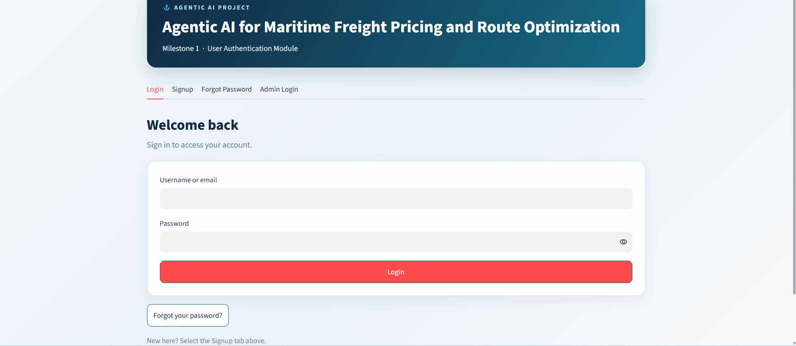
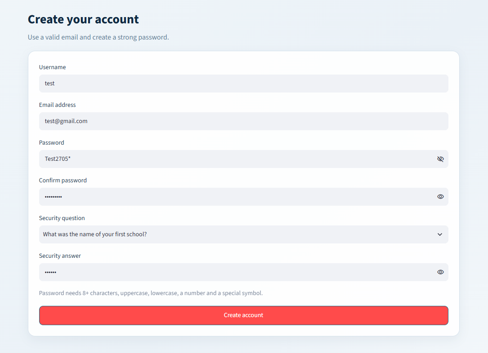
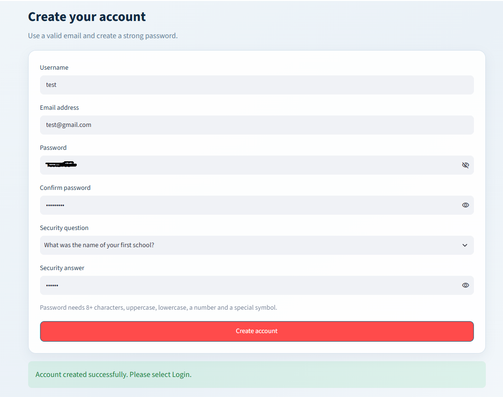
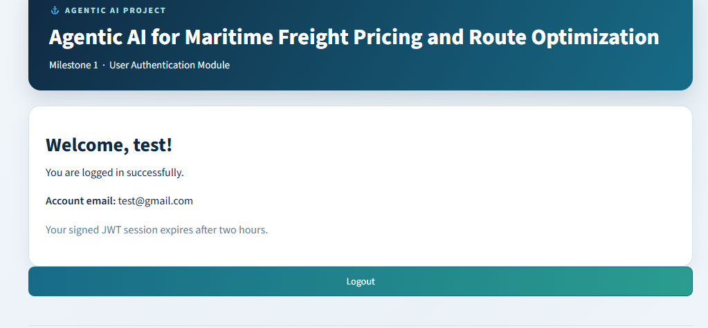
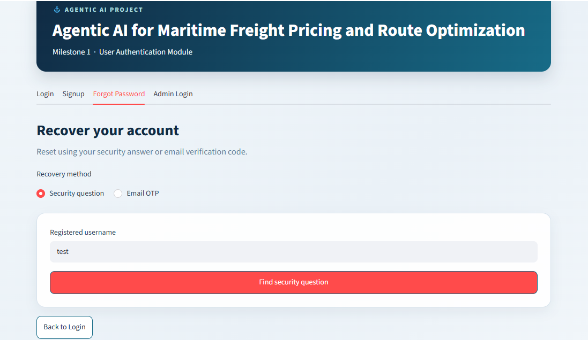
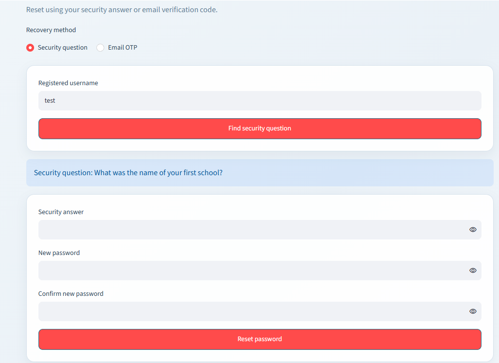
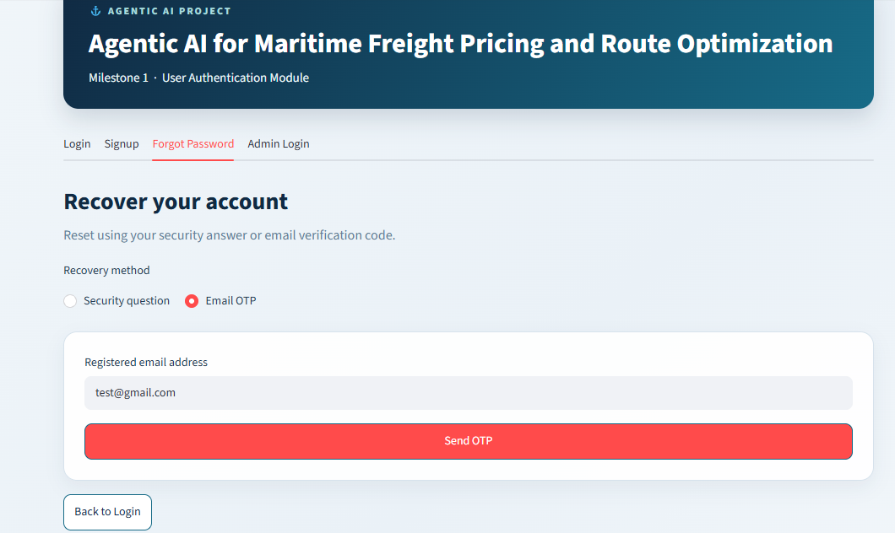
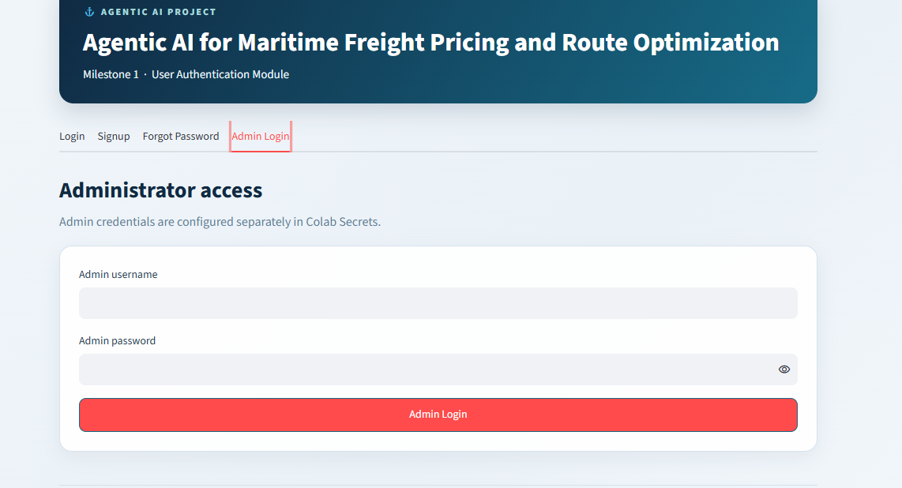

# Agentic AI for Maritime Freight Pricing and Route Optimization

## Milestone 1: User Authentication Module

This repository contains Milestone 1 of the project: a Streamlit-based
user authentication module. This milestone focuses on account
registration, login, password recovery, and a separate administrator
login. It does not yet implement maritime freight pricing or route
optimization.

## Features

-   User signup with username, email, password, password confirmation,
    and a security question/answer.
-   Email-format and password-strength validation.
-   Password hashing using `bcrypt`.
-   Login using username or email.
-   Signed JSON Web Tokens (JWT) for authenticated sessions, with a
    two-hour expiry.
-   Password recovery through a security question or email OTP.
-   OTP expiry after five minutes.
-   Separate administrator login using credentials supplied through
    environment variables or notebook secrets.
-   Admin dashboard that lists registered usernames and email addresses
    only; passwords are not displayed.
-   SQLite database for registered accounts.

## Technology Stack

-   Python
-   Streamlit
-   SQLite
-   bcrypt
-   PyJWT
-   Gmail SMTP for OTP delivery

## Project Files

-   `app.py` --- main Streamlit application.
-   `README.md` --- project documentation.

## Setup

### 1. Install dependencies

``` bash
pip install streamlit PyJWT bcrypt
```

If you are using Google Colab and exposing the app through ngrok,
install and configure `pyngrok` separately as needed for your notebook
workflow.

### 2. Configure secrets

Set these values using your notebook's Secrets feature or environment
variables. Never write real values directly into `app.py` or this
README.

-   `JWT_SECRET` --- a long, random signing secret for JWTs.
-   `EMAIL_ADDRESS` --- the Gmail address used to send OTP messages.
-   `EMAIL_PASSWORD` --- a Gmail App Password, not your normal Gmail
    password.
-   `ADMIN_USERNAME` --- separate administrator username.
-   `ADMIN_PASSWORD` --- separate administrator password.

If using ngrok, keep `NGROK_AUTHTOKEN` in notebook secrets as well. The
app's OTP feature requires the email settings; login token creation
requires `JWT_SECRET`.

### 3. Run the application

From the folder containing `app.py`, run:

``` bash
streamlit run app.py
```

In Google Colab, run the equivalent Streamlit command in a notebook cell
and use your configured tunnel link to open the app.

## Validation Rules

-   Username must contain at least two characters.
-   Email must match the application's email-format validation.
-   Password must be 8--16 characters and include at least one uppercase
    letter, lowercase letter, number, and special character. Spaces are
    not allowed.
-   Confirm password must match the password.
-   Username and email must be unique.
-   OTP is valid for five minutes.
-   JWT session expires after two hours.

Note: email-format validation checks the format only; it does not prove
that an email inbox exists. OTP delivery and verification are used for
email-based password recovery.

## Application Flow

1.  **Signup:** User enters registration details and selects a security
    question.
2.  **Login:** User signs in using their username or email and password.
3.  **Forgot Password:** User chooses security-question recovery or
    email OTP.
4.  **Admin Login:** Administrator signs in using the separately
    configured admin credentials.
5.  **Dashboard:** The user sees a welcome message; the administrator
    can view registered usernames and emails.

## Screenshots

Add screenshots of the working application after testing. Recommended
order:

1.  **Login page**


2.  **Signup page**


3.  **Successful signup**


4.  **Successful login / user dashboard**


5.  **Forgot Password --- security question**


  

6.  **Forgot Password --- OTP**


7.  **Admin login** 



## Current Scope

This milestone covers authentication only. Maritime freight price
prediction, route optimization, and agentic AI workflows are outside the
scope of this authentication module unless implemented in a later
milestone.
