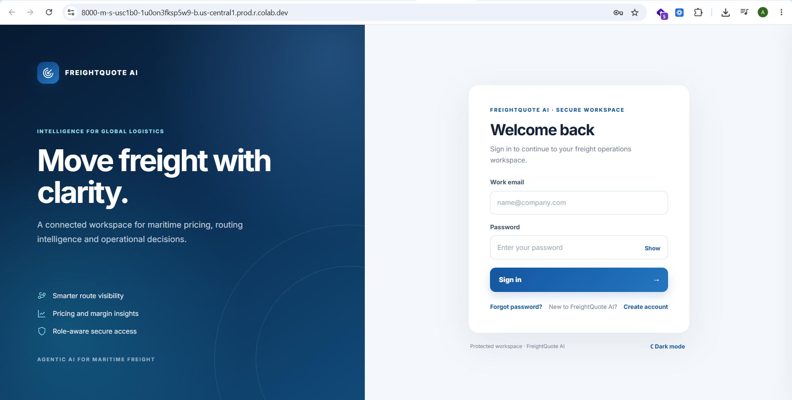
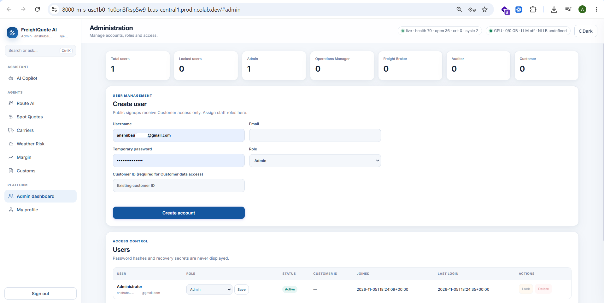
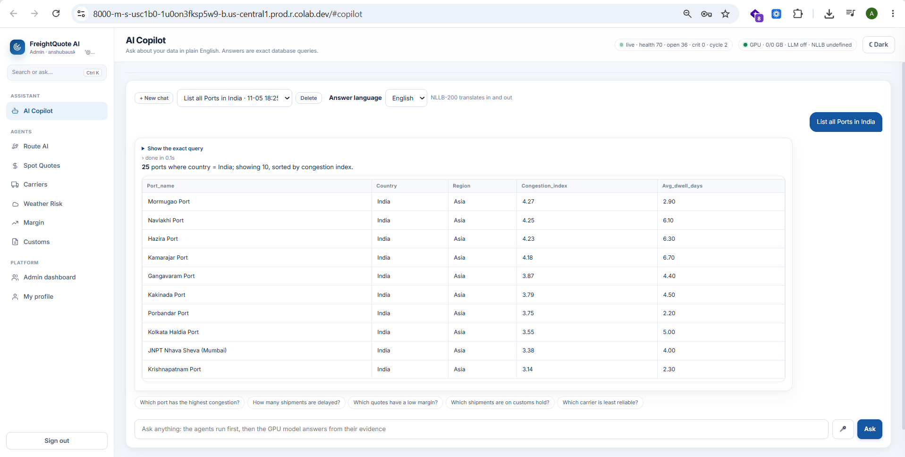
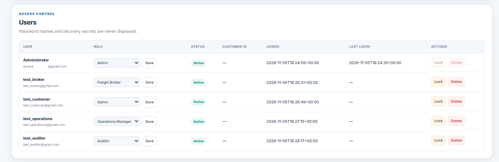

# FreightQuote AI – Milestone 2

**Infosys Springboard Internship 7.0 | Batch 4**

FreightQuote AI is a collaborative freight operations application featuring authentication, role-based access control, an Admin Dashboard and an AI Copilot.

## Team Contributions

| Team Member | Contribution |
|---|---|
| Chetana P Kulkarni | Authentication and Security |
| Ankit Kumar | Roles and Admin Backend |
| Venu Kumar P J | AI Copilot |
| Anshu Bauskar | Frontend, UI Design, Database Integration and Code Merging |

## Project Structure

```text
Milestone2/
├── FreightQuote_Milestone2.ipynb
├── README.md
├── AI Copilot/
├── Admin Backend/
├── Admin Dashboard/
├── Authentication/
├── RBAC_CUSTOMER_ISOLATION/
└── screenshots/
```

## Technologies Used

Python · FastAPI · SQLite · JWT · bcrypt · HTML · CSS · JavaScript · Google Colab

## Run the Project

The individual Python modules contributed by team members are integrated into one Jupyter Notebook.

1. Open `FreightQuote_Milestone2.ipynb` in Google Colab.
2. Configure the required credentials in Colab Secrets:
   - `JWT_SECRET`
   - `ADMIN_EMAIL_ID`
   - `ADMIN_PASSWORD`
3. Add `NGROK_AUTHTOKEN` if required for public access.
4. Select **Runtime → Run all**.
5. Open the application URL generated by the notebook.
6. Log in using the configured Admin credentials.

**Note:** Run the integrated notebook to start the application. Individual `.py` files are retained as module source code.

## Key Features

- User authentication and password security.
- Five roles: Admin, Operations Manager, Freight Broker, Auditor and Customer.
- Role-based permissions and customer data isolation.
- Admin dashboard and user management.
- AI Copilot for freight-related queries.
- Browser-based application interface.

## Screenshots

### Login Page


### Admin Dashboard


### AI Copilot


### Role-Based Access Control


## Security

- Never commit passwords, API keys, JWT secrets or database files.
- Keep Colab credentials in Secrets.
- Use dummy accounts for demonstrations.

## Disclaimer

Developed for academic purposes as part of Infosys Springboard Internship 7.0, Batch 4 – Milestone 2.
