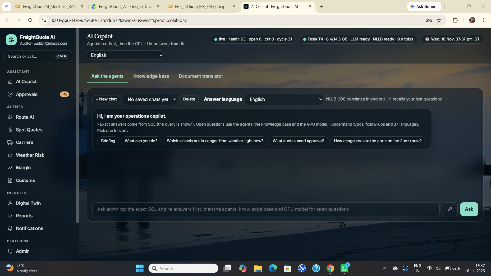
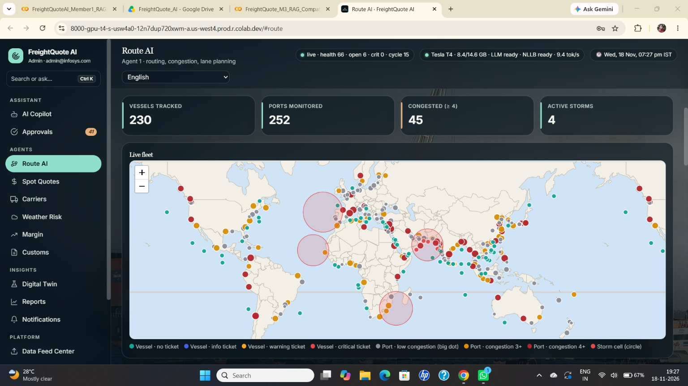
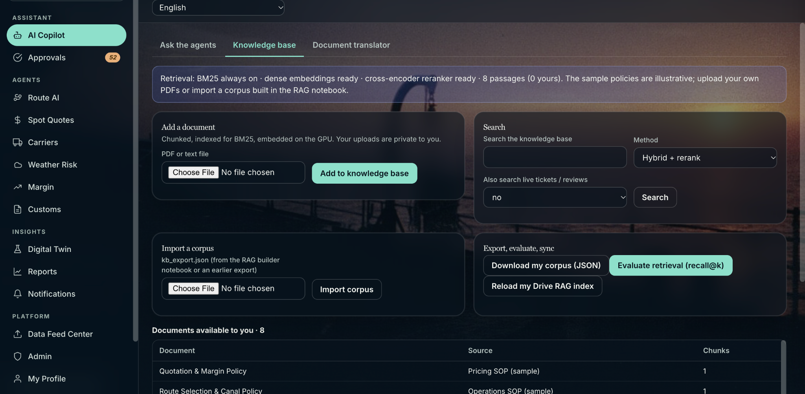
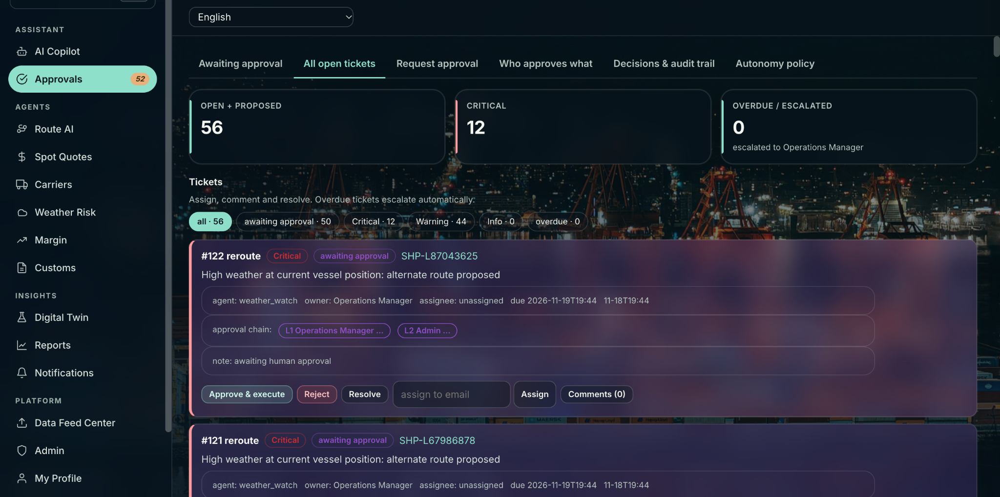
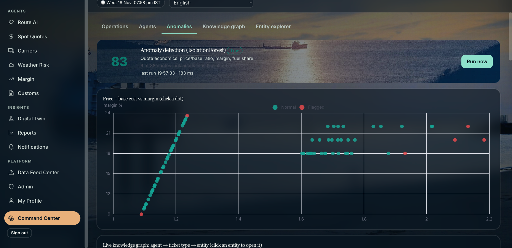
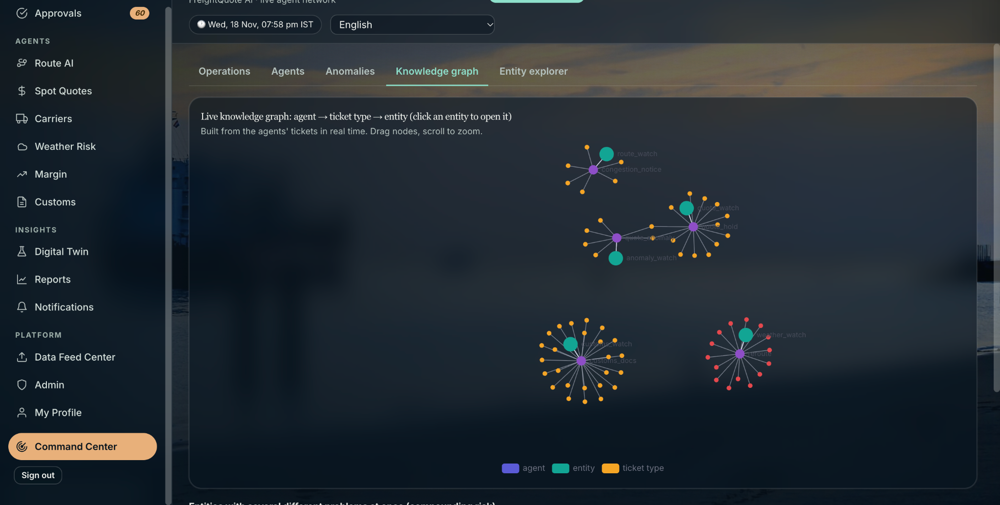

# FreightQuote AI

**Agentic Maritime Intelligence & Freight Decision Platform**  
Infosys Springboard Internship 7.0 · Batch 4 · Team 2 · Milestone 3

FreightQuote AI is a maritime freight-operations demonstrator that brings route planning, weather-risk assessment, freight pricing, customs checks, approvals and fleet monitoring into one workspace. It combines specialist agents with a conversational Copilot and a retrieval-augmented knowledge base (RAG), while keeping sensitive decisions subject to human approval.

## Key capabilities

- **Multi-agent quotation workflow:** route, weather, pricing, customs, margin, document and alert agents.
- **Fleet monitoring:** watcher agents and anomaly detection for operational changes.
- **AI Copilot & RAG:** natural-language access to operational records and freight knowledge using FAISS and BM25 retrieval.
- **Decision support:** route, quote, carrier, weather and customs simulators, plus Digital Twin scenarios.
- **Governance & reporting:** role-based access, approval workflows, audit trail and report exports.

## Screenshots

**Freight operations dashboard**

**Route intelligence and fleet map**

**RAG knowledge base**

**Human approvals and governance**

**Operational anomaly detection**

**Knowledge graph**

## Technology stack

Python · FastAPI · JavaScript · SQLite · LangGraph · FAISS · BM25 · Hugging Face Transformers · Qwen2.5-Instruct · NLLB-200 · scikit-learn · Google Colab

## Run the project

1. Open the notebooks in **Google Colab**.
2. Run `FreightQuoteAI_RAG_Builder.ipynb` first to prepare the RAG data/index.
3. Open `FreightQuote_M3_Notebook.ipynb`, select a **T4 GPU** runtime, and run the notebook cells in order.
4. Use the application link generated by the final cell.

Refer to the notebooks for runtime setup, optional credentials and demo login details.

## Project files

- `FreightQuoteAI_RAG_Builder.ipynb` — RAG knowledge-base preparation.
- `FreightQuote_M3_Notebook.ipynb` — integrated application and runtime.
- `FreightQuote_AI_Milestone3.pdf` — Milestone 3 presentation.
- `screenshots/` — application evidence and feature walkthrough.

## Notes

This is a project demonstrator, not a production maritime tracking service. Vessel positions, shipment records and some freight prices use simulated/demo data unless external feeds are configured. Weather data may use an online source. Email, messaging and other optional integrations require their own credentials.

---

**Team 2** · Anshu Bauskar · Aparna Pulimoottil Jaykumar · Venu Kumar P J · Abhinaya Sama · Sahana NS  
**Mentor:** Mohamedsipli M
